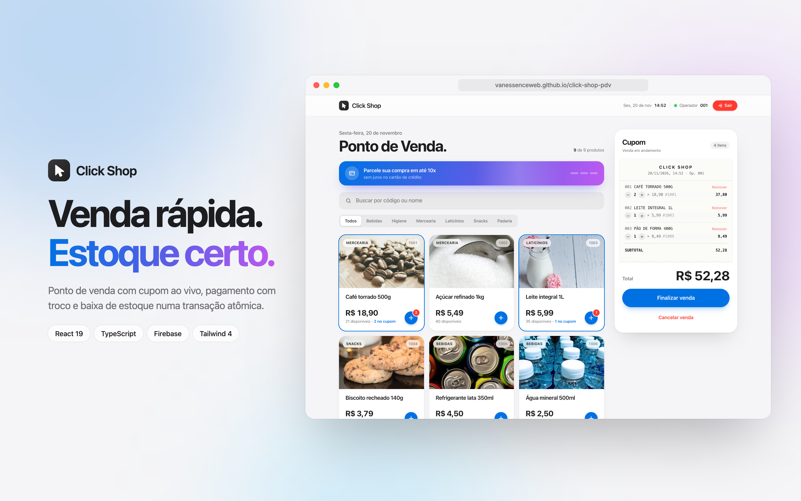
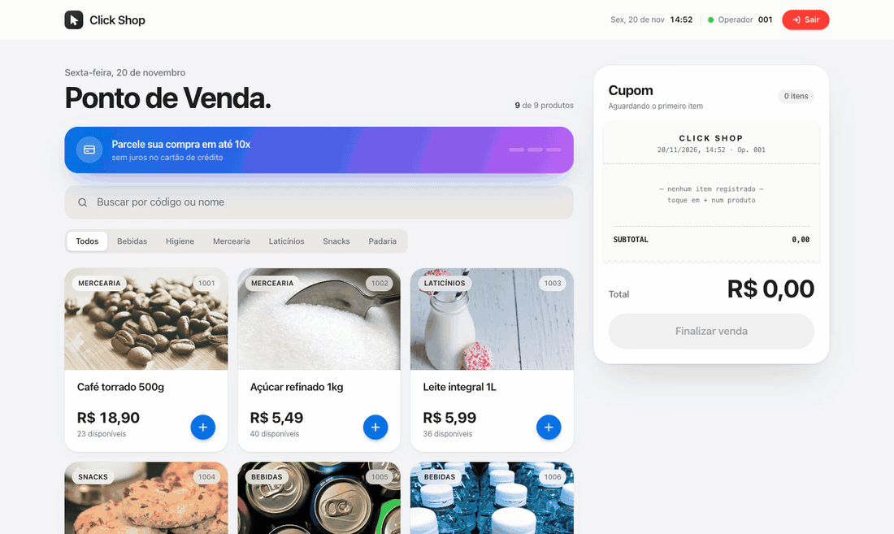
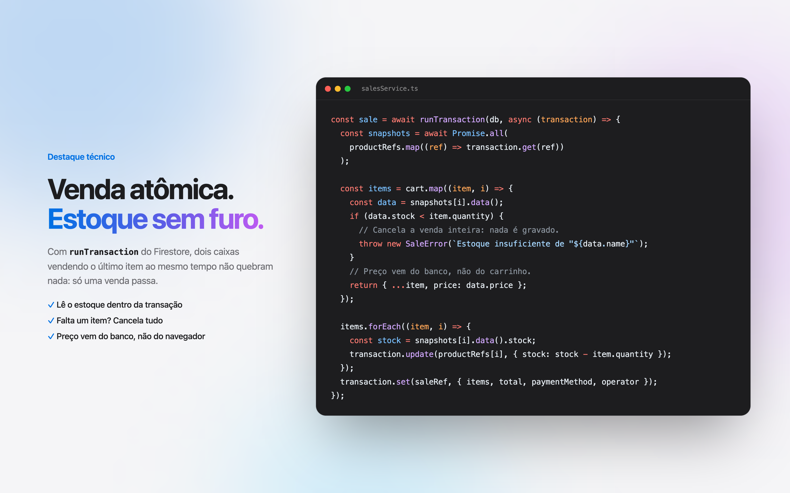
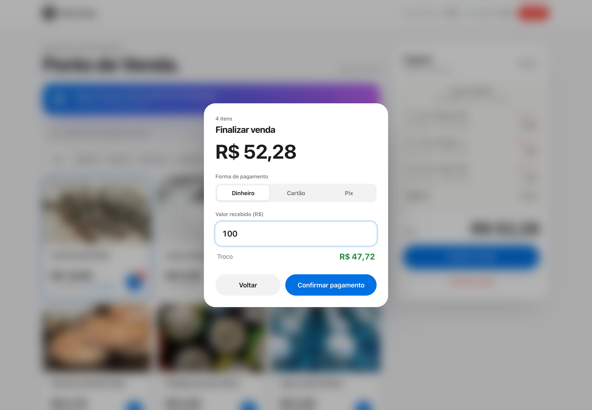
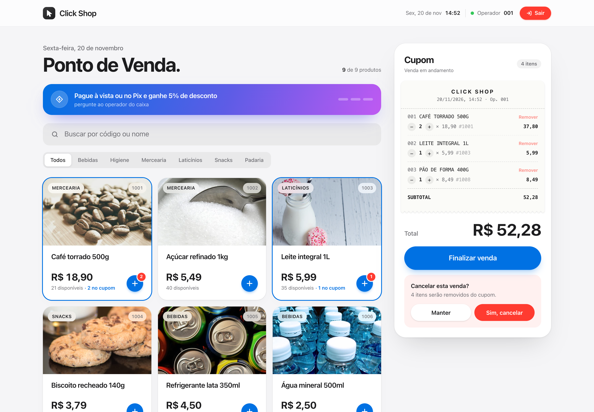

# Click Shop PDV



Ponto de venda web para uma loja de conveniência: o operador abre o caixa, busca produtos por código ou nome e vê o **cupom sendo montado ao vivo** enquanto registra os itens. Recebe em dinheiro, cartão ou Pix (com cálculo de troco) e emite o comprovante. A baixa de estoque acontece numa **transação atômica no Firestore**.

**[Ver o app no ar →](https://vanessenceweb.github.io/click-shop-pdv/)** · entre com qualquer código de operador de 3 a 20 letras ou números (ex.: `001`).

## Funcionalidades



- **Cupom ao vivo:** cada item "sai da impressora" no cupom, com número da linha, código, quantidade × preço e subtotal
- **Estoque disponível no card:** ao adicionar um item, o card já mostra quanto sobra (`estoque − itens no cupom`)
- **Faixa de promoções** girando para quem está comprando acompanhar na tela (pausa com o mouse em cima)
- **Busca em tempo real** por código ou nome, com filtro por categoria
- **Pagamento** em dinheiro, cartão ou Pix, com cálculo de troco e validação do valor recebido
- **Cancelar venda** com confirmação na própria tela, sem pop-up do navegador
- **Comprovante** no estilo cupom de bobina, pronto para imprimir, e botão **Próximo cliente**
- **Login de operador** com validação e rotas protegidas (React Router); data e hora do caixa no topo
- **Estoque sincronizado** entre caixas via `onSnapshot` do Firestore

## Destaque técnico: venda atômica



Se dois caixas vendem o último item ao mesmo tempo, quem garante que o estoque não fica negativo? A venda inteira roda dentro de um `runTransaction` ([`src/services/salesService.ts`](src/services/salesService.ts)):

1. relê o estoque de cada produto **dentro** da transação;
2. se faltar qualquer item, lança um erro e **nada** é gravado;
3. baixa o estoque e grava a venda de uma vez só.

Se outro caixa alterar o mesmo produto no meio do caminho, o Firestore refaz a transação com os dados novos. O **preço e o nome vêm do banco**, não do carrinho no navegador, então alterar o front-end não muda o valor cobrado. Os valores são arredondados para centavos (`toCents`) para evitar erros de ponto flutuante como `0.1 + 0.2`.

## Telas

| Abrir o caixa | Pagamento com troco |
| --- | --- |
|  |  |

| Cancelar venda |
| --- |
|  |

## Design

Visual inspirado na Apple: fonte do sistema (SF Pro), cinza `#F5F5F7`, azul de ação `#0071E3`, vermelho de sistema para ações destrutivas, vidro fosco e animações curtas que respeitam `prefers-reduced-motion`.

As fotos dos produtos são **CC0 (domínio público)**, encontradas pelo [Openverse](https://openverse.org). Créditos em [`public/products/CREDITOS.md`](public/products/CREDITOS.md).

## Stack

React 19 · TypeScript · Vite · Tailwind CSS 4 · Firebase (Firestore) · React Router · GitHub Actions + GitHub Pages

## Estrutura

```
src/
├── components/   # brand, layout, cart (cupom ao vivo), checkout, promo, routing
├── hooks/        # useAuth (operador), useProducts (Firestore em tempo real), useNow (relógio)
├── pages/        # LoginPage, PdvPage
├── services/     # salesService (transação), productsService
├── utils/        # cartUtils (regras do carrinho), productImage
└── types/        # Product, CartItem, Sale…
```

## Rodando localmente

```bash
npm install
npm run dev      # http://localhost:5173/click-shop-pdv/
npm run build    # checa os tipos e gera o build de produção
```

Na primeira vez, se o catálogo estiver vazio, a tela de venda mostra o botão **Cadastrar produtos de exemplo**.

## Deploy

A cada push na `main`, o GitHub Actions ([`.github/workflows/deploy.yml`](.github/workflows/deploy.yml)) roda o build e publica no GitHub Pages.

---

Feito por [Vanessa Rafaella](https://github.com/VANESSENCEWEB).
